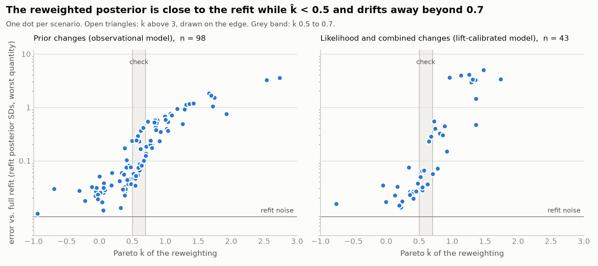

# Reweighting instead of refitting in PyMC-Marketing

Checking a prior or a likelihood assumption usually means refitting once per alternative. Instead: **fit once, then reweight the saved MCMC draws** (Pareto-smoothed importance sampling). Pareto k̂ and the effective sample size (ESS) say when to trust the result and when to refit.

This repository holds two notebooks proposed for [PyMC-Marketing](https://github.com/pymc-labs/pymc-marketing)'s example gallery, `mmm_prior_reweighting` and `mmm_likelihood_reweighting`, and the evidence behind them. They use the model and data of PyMC-Marketing's [prior and likelihood sensitivity notebook](https://www.pymc-marketing.io/en/1.2.0/notebooks/mmm/mmm_prior_sensitivity.html). That notebook asks *which* priors the posterior is sensitive to. These ask *what the posterior becomes* under a specific alternative.

The same method for Google Meridian: [prior_sensitivity_meridian](https://github.com/hansamos/prior_sensitivity_meridian).

| Pareto k̂ | verdict |
|---|---|
| < 0.5 | use the reweighted posterior |
| 0.5 – 0.7 | check it with a refit if it matters |
| ≥ 0.7 | refit |

The core of the method:

```python
log_w = new_log_density(draws) - reference_log_density(draws)     # one number per draw
log_w, k_hat = array_stats.psislw(-log_w)                         # ArviZ 1.x smooths exp(-x): negate
w = np.exp(log_w - log_w.max()); w /= w.sum()
new_mean = (w[:, None] * draws).sum(axis=0)                       # posterior mean under the change
```

## Notebooks

| Notebook | Content |
|---|---|
| [mmm_prior_reweighting](notebooks/mmm_prior_reweighting.ipynb) | Priors: a new business prior checked against a refit, a sweep with no refits, a case where reweighting cannot help, and the relation to power-scaling. |
| [mmm_likelihood_reweighting](notebooks/mmm_likelihood_reweighting.ipynb) | Likelihoods: stronger and weaker lift tests, StudentT sales noise, and combined changes. |

Each runs in about 3 minutes on 6 CPU cores. They follow PyMC-Marketing's docs conventions, so the `{ref}` cross-references show as plain text on GitHub. To run them here, install the versions in `evidence/requirements.txt` and put the dataset in `data/`:

```
mkdir -p data && curl -o data/mmm_roas_data.csv https://raw.githubusercontent.com/pymc-labs/pymc-marketing/main/data/mmm_roas_data.csv
```

## Evidence

Reweighted posteriors against independent full refits, PyMC-Marketing 1.3.0, simulated data (two channels, 131 weeks):

| Pareto k̂ | prior changes: scenarios | error | likelihood changes: scenarios | error |
|---|---|---|---|---|
| <0.3 | 20 | 0.027 | 8 | 0.017 |
| 0.3-0.5 | 20 | 0.043 | 8 | 0.026 |
| 0.5-0.7 | 20 | 0.084 | 8 | 0.057 |
| 0.7-1 | 19 | 0.24 | 9 | 0.32 |
| >=1 | 19 | 0.94 | 10 | 3.4 |

Error: worst of nine posterior quantities per scenario (ROAS, adstock, saturation and the noise scale), in refit posterior SDs, median over scenarios. Two refits of one scenario differ by 0.009 (priors) and 0.007 (likelihood).



Limits: simulated data, one reference fit per model (k̂ itself moves between reference fits, by up to about 0.25 for priors and 0.4 for likelihoods), small likelihood bins. For likelihood changes at k̂ ≥ 1 the reweighted mean was no better than the reference on the quantities the change moves. Scripts, scenarios, tables and figures: [evidence/](evidence/README.md).

## Scope

Only a prior or a likelihood term changes: same data, same sampled variables. A prior on a new parameter (for example on the degrees of freedom of a StudentT likelihood), a different adstock or saturation function, new controls or more data need a refit.

## Reference

Vehtari, A., Simpson, D., Gelman, A., Yao, Y., Gabry, J. (2024). Pareto smoothed importance sampling. *Journal of Machine Learning Research*, 25(72), 1-58.

## License

Apache 2.0, see [LICENSE](LICENSE).
